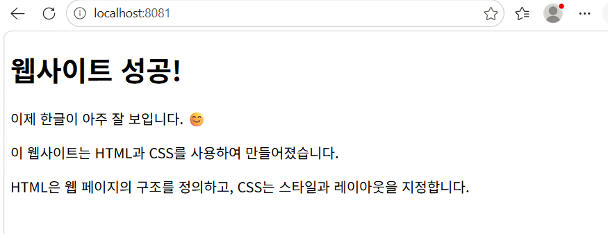
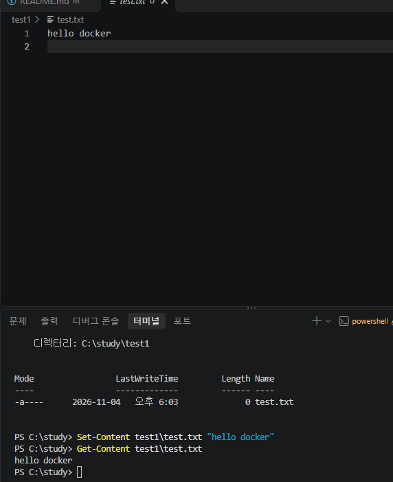
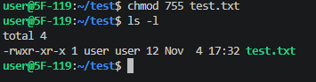
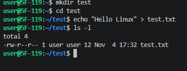
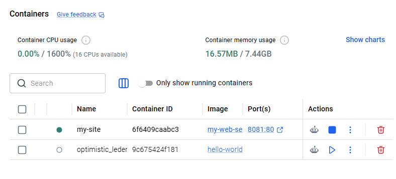
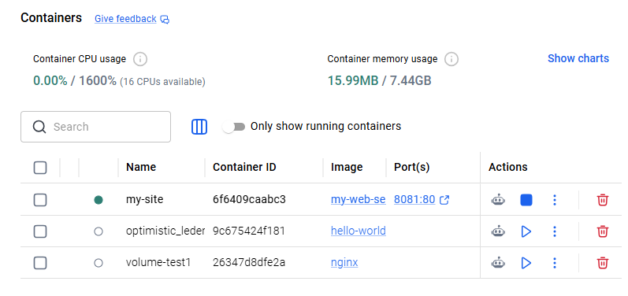
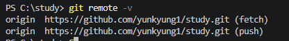

# 코디세이 개발 워크스테이션 구축 미션

## 1. 프로젝트 개요
본 프로젝트는 개발 환경을 구축하고,
터미널 명령어, 파일 권한, Docker, Git/GitHub의
기본 사용법을 익히기 위한 실습입니다.

## 2. 수행 항목 체크리스트

- [x] 터미널 기본 명령어 실습
- [x] Linux 파일 권한 변경
- [x] Docker 설치 및 실행 확인
- [x] Docker 이미지 및 컨테이너 관리
- [x] Dockerfile 이미지 빌드
- [x] 웹 서버 포트 매핑 확인
- [x] Docker 볼륨 데이터 보존
- [x] Git 설정 확인
- [x] GitHub 원격 저장소 연결

## 3. 실행 환경

- 운영체제(OS): Windows (빌드 26300.9711)
- 터미널 및 셸: Windows PowerShell
- 코드 편집기: Visual Studio Code (VS Code)
- Linux 실습 환경: Ubuntu (WSL2)
- WSL 버전: 3.0.3.0
- Docker Engine: 29.9.2
- Docker Desktop: 4.98.0
- Git 버전: 2.56.0.windows.4
- Docker 실행 상태: 컨테이너 2개 실행 중, 이미지 2개
- Ubuntu 상태: 설치 완료 (현재 Stopped)
- 프로젝트 경로: `C:\study`
- GitHub 저장소: https://github.com/yunkyung1/study

### 개발 환경 확인 명령어

다음 명령어를 실행하여 설치 버전과 동작 상태를 확인하였습니다.

docker --version
docker info
wsl --version
wsl -l -v
git --version
---

## 4. 실행 방법
1. 이미지 빌드: `docker build -t my-web-server .`
2. 컨테이너 실행: `docker run -d -p 8081:80 --name my-site my-web-server`

결과 확인
- 브라우저에서 `localhost:8081` 접속

## 5.  터미널 기본 명령어 실습
### 1. 현재 작업 경로 확인

- 명령어: `pwd`
- 실행 결과: `C:\study`
<!--  -->
PS C:\study> pwd

Path    
----    
C:\study

### 2. 작업 폴더의 파일 목록 확인

- 명령어: `dir`
- 실행 경로: `C:\study`

PS C:\study> dir
    디렉터리: C:\study

Mode                 LastWriteTime         Length Name                  
----                 -------------         ------ ----                  
d-----      2026-11-03   오후 1:17                app                   
d-----      2026-11-04   오후 1:47                docs                  
d-----      2026-11-04   오후 1:47                practice              
-a----      2026-11-03  오후 12:42             71 Dockerfile            
-a----      2026-11-03  오후 12:42             72 hello.txt             
-a----      2026-11-03  오후 12:42            439 index.html            
-a----      2026-11-04   오후 5:49           6194 README.md             

### 3. 폴더 이동

- 명령어: `cd app`
- 이동 전 경로: `C:\study`
- 이동 후 경로: `C:\study\app`
PS C:\study> cd app
PS C:\study\app> 

### 4. 상위 폴더로 이동

- 명령어: `cd ..`
- 이동 전 경로: `C:\study\app`
- 이동 후 경로: `C:\study`
PS C:\study\app> cd ..
PS C:\study> 

### 5. 새 폴더 생성

- 명령어: `mkdir test1`
- 생성 경로: `C:\study> mkdir test1`
PS C:\study> mkdir test1

    디렉터리: C:\study

Mode                 LastWriteTime         Length Name                  
----                 -------------         ------ ----                  
d-----      2026-11-04   오후 5:59                test1                 

### 6. 파일 및 폴더 목록 조회

- 명령어: `ls`
- 실행 경로: `C:\study`
PS C:\study> ls

    디렉터리: C:\study

Mode                 LastWriteTime         Length Name                  
----                 -------------         ------ ----                  
d-----      2026-11-03   오후 1:17                app                   
d-----      2026-11-04   오후 1:47                docs                  
d-----      2026-11-04   오후 1:47                practice              
d-----      2026-11-04   오후 5:59                test1                 
-a----      2026-11-03  오후 12:42             71 Dockerfile            
-a----      2026-11-03  오후 12:42             72 hello.txt             
-a----      2026-11-03  오후 12:42            439 index.html            
-a----      2026-11-04   오후 6:00           6696 README.md   

### 트러블슈팅 1. PowerShell에서 ls -a 오류

- 문제: `ls -a` 실행 시 AmbiguousParameter 오류 발생
- 원인: Linux와 PowerShell의 명령어 옵션 차이
- 확인: PowerShell에서 `ls -Force` 정상 실행
- 해결: 숨김 파일 확인 시 `ls -Force` 사용
- 배운 점: 같은 명령어라도 운영 환경에 따라 옵션이 다를 수 있다.

### 트러블슈팅 2. PowerShell에서 한글 깨짐 현상

**문제**
- `cat hello.txt` 실행 시 한글이 깨져서 출력됨.

**원인 가설**
- PowerShell의 기본 파일 읽기 인코딩이
  파일의 인코딩과 일치하지 않는 것으로 추정함.

**확인 과정**
- VSCode에서는 한글이 정상적으로 표시됨.
- `Get-Content -Encoding UTF8 hello.txt` 실행

**해결 결과**
- UTF-8 인코딩을 지정하자 한글이 정상 출력됨.

**배운 점**
- 파일의 인코딩과 읽기 방식이 다르면
  한글이 깨질 수 있다는 것을 확인함.

  ### 7. 새 파일 생성

- 명령어: `New-Item test1\test.txt -ItemType File`
- 생성 위치: `C:\study\test1`
PS C:\study> New-Item test1\test.txt -ItemType File

    디렉터리: C:\study\test1

Mode                 LastWriteTime         Length Name                  
----                 -------------         ------ ----                  
-a----      2026-11-04   오후 6:03              0 test.txt              

### 9. 파일 내용 수정 및 확인

- 수정 명령어: `Set-Content test1\test.txt "hello docker"`
- 확인 명령어: `Get-Content test1\test.txt`

PS C:\study> Set-Content test1\test.txt "hello docker"
PS C:\study> Get-Content test1\test.txt
hello docker
PS C:\study> 

### 10. 파일 복사

- 명령어: `Copy-Item test1\test.txt test1\test-copy.txt`
- 원본 파일: `C:\study\test1\test.txt`
- 복사 파일: `C:\study\test1\test-copy.txt`
  확인은 cd test1 가서 dir 해봄 cd ..
 
  디렉터리: C:\study\test1

Mode                 LastWriteTime         Length Name                                             
----                 -------------         ------ ----                                             
-a----      2026-11-04   오후 6:10             14 test-copy.txt                                    
-a----      2026-11-04   오후 6:10             14 test.txt   

### 11. 파일 이름 변경

- 명령어: `Rename-Item test1\test-copy.txt test-backup.txt`
- 변경 전 파일명: `test-copy.txt`
- 변경 후 파일명: `test-backup.txt`
PS C:\study> Rename-Item test1\test-copy.txt test-backup.txt
PS C:\study> dir test1

    디렉터리: C:\study\test1

Mode                 LastWriteTime         Length Name                                             
----                 -------------         ------ ----                                             
-a----      2026-11-04   오후 6:10             14 test-backup.txt                                  
-a----      2026-11-04   오후 6:10             14 test.txt                                         

### 12. 파일 이동

- 명령어: `Move-Item test1\test.txt test-moved.txt`
 `test.txt`를 `C:\study`로 이동하면서 이름을 `test-moved.txt`로 변경하였다.

PS C:\study> Move-Item test1\test.txt test-moved.txt
PS C:\study> dir test-moved.txt

    디렉터리: C:\study

Mode                 LastWriteTime         Length Name                                             
----                 -------------         ------ ----                                             
-a----      2026-11-04   오후 6:10             14 test-moved.txt  

### 13. 파일 삭제

- 명령어: `Remove-Item test-moved.txt`
 `test-moved.txt` 파일이 삭제되었다.

PS C:\study> Remove-Item test-moved.txt
PS C:\study> Test-Path test-moved.txt
False

## 6. Linux 파일 권한 실습

### 실습 환경
- 운영체제: Ubuntu (WSL2)
- 실습 폴더: `/home/user/test`
- 실습 파일: `test.txt`

### 1. 폴더 및 파일 생성

cd ~
mkdir test
cd test
echo "Hello Linux" > test.txt
ls -l

## 7. Docker Hello World 실행 확인

- 실행 명령어: `docker run hello-world`
PS C:\study> docker run hello-world
Unable to find image 'hello-world:latest' locally
latest: Pulling from library/hello-world
4f55086f7dd0: Pull complete 
Digest: sha256:c567b231f65614688711a75f31518a064258a51d442117a3e771a3a8fdba78ef
Status: Downloaded newer image for hello-world:latest

Hello from Docker!
This message shows that your installation appears to be working correctly.

## 8. Docker 볼륨 데이터 보존 실습
컨테이너 삭제 후에도 볼륨에 저장된 데이터가 유지되는지 확인

볼륨 생성: docker volume create mydata
파일 저장: docker run --name volume-test1 -v mydata:/data nginx sh -c "echo HelloVolume > /data/test.txt"
컨테이너 삭제: docker rm volume-test1
데이터 확인: docker run --rm -v mydata:/data nginx cat /data/test.txt

PS C:\study> docker volume create mydata
mydata
PS C:\study> docker run --name volume-test1 -v mydata:/data nginx sh -c "echo HelloVolume > /data/test.txt"
PS C:\study> docker rm volume-test1
volume-test1
PS C:\study> docker run --rm -v mydata:/data nginx cat /data/test.txt
HelloVolume

                  
## 9. Git 설정 및 GitHub 연결 확인

- 실행 명령어: `git remote -v`
PS C:\study> git remote -v                         
origin  https://github.com/yunkyung1/study.git (fetch)
origin  https://github.com/yunkyung1/study.git (push)     

