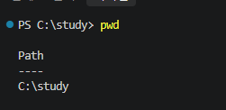

# 나의 첫 웹 서버

## 1. 프로젝트 개요
- 도커(Docker)를 이용해 Nginx 웹 서버를 실행하고, 나만의 웹 페이지를 띄우는 프로젝트입니다.

## 2. 사용한 기술
- Docker, Nginx, HTML, Git/GitHub

## 3. 실행 방법
1. 이미지 빌드: `docker build -t my-web-server .`
2. 컨테이너 실행: `docker run -d -p 8081:80 --name my-site my-web-server`

## 4. 결과 확인
- 브라우저에서 `localhost:8081` 접속

## 터미널 기본 명령어 실습

### 1. 현재 작업 경로 확인

- 명령어: `pwd`
- 실행 결과: `C:\study`
- 설명: 현재 작업 중인 폴더의 위치를 확인하였다.
- 결과: 정상 실행

### 2. 작업 폴더의 파일 목록 확인

- 명령어: `dir`
- 실행 경로: `C:\study`
- 확인한 폴더: `app`
- 확인한 파일: `Dockerfile`, `hello.txt`, `index.html`, `README.md`
- 학습 내용: `dir` 명령어를 이용하여 폴더와 파일의 목록, 크기, 수정 시간을 확인하였다.
- 결과: 정상 실행

### 3. 폴더 이동

- 명령어: `cd app`
- 이동 전 경로: `C:\study`
- 이동 후 경로: `C:\study\app`
- 학습 내용: `cd` 명령어를 사용하여 하위 폴더로 이동하였다.
- 결과: 정상 실행

### 4. 상위 폴더로 이동

- 명령어: `cd ..`
- 이동 전 경로: `C:\study\app`
- 이동 후 경로: `C:\study`
- 학습 내용: `cd ..` 명령어를 이용하여 상위 폴더로 이동하였다.
- 결과: 정상 실행

### 5. 새 폴더 생성

- 명령어: `mkdir practice`
- 생성 경로: `C:\study\practice`
- 학습 내용: `mkdir` 명령어를 사용하여 새로운 폴더를 생성하였다.
- 실행 결과: `practice` 폴더 생성 확인
- 결과: 정상 실행

### 6. 파일 및 폴더 목록 조회

- 명령어: `ls`
- 실행 경로: `C:\study`
- 확인한 폴더: `app`, `practice`
- 확인한 파일: `Dockerfile`, `hello.txt`, `index.html`, `README.md`
- 학습 내용: `ls` 명령어로 현재 폴더의 내용을 확인하고, PowerShell에서 `dir`과 동일한 결과가 출력되는 것을 확인하였다.
- 결과: 정상 실행

### 트러블슈팅 1. PowerShell에서 ls -a 오류

- 문제: `ls -a` 실행 시 AmbiguousParameter 오류 발생
- 원인: Linux와 PowerShell의 명령어 옵션 차이
- 확인: PowerShell에서 `ls -Force` 정상 실행
- 해결: 숨김 파일 확인 시 `ls -Force` 사용
- 배운 점: 같은 명령어라도 운영 환경에 따라 옵션이 다를 수 있다.

### 트러블슈팅 2. PowerShell에서 한글 깨짐 현상

**문제**
- `cat hello.txt` 실행 시 한글이 깨져서 출력됨.

**원인 가설**
- PowerShell의 기본 파일 읽기 인코딩이
  파일의 인코딩과 일치하지 않는 것으로 추정함.

**확인 과정**
- VSCode에서는 한글이 정상적으로 표시됨.
- `Get-Content -Encoding UTF8 hello.txt` 실행

**해결 결과**
- UTF-8 인코딩을 지정하자 한글이 정상 출력됨.

**배운 점**
- 파일의 인코딩과 읽기 방식이 다르면
  한글이 깨질 수 있다는 것을 확인함.

  ### 7. 새 파일 생성

- 명령어: `New-Item practice\test.txt -ItemType File`
- 생성 위치: `C:\study\practice\test.txt`
- 실행 결과: 크기가 0바이트인 빈 파일 생성
- 학습 내용: PowerShell에서 새 파일을 만드는 방법을 학습하였다.
- 결과: 정상 실행

### 9. 파일 내용 수정 및 확인

- 수정 명령어: `Set-Content practice\test.txt "hello docker"`
- 확인 명령어: `Get-Content practice\test.txt`
- 실행 결과: `hello docker`
- 학습 내용: 파일의 기존 내용을 수정하고 저장된 결과를 확인하였다.
- 결과: 정상 실행

### 10. 파일 복사

- 명령어: `Copy-Item practice\test.txt practice\test-copy.txt`
- 원본 파일: `C:\study\practice\test.txt`
- 복사 파일: `C:\study\practice\test-copy.txt`
- 실행 결과: `test.txt`와 `test-copy.txt` 두 파일이 생성된 것을 확인하였다.
- 학습 내용: `Copy-Item` 명령어를 사용하여 원본 파일을 유지하면서 복사본을 생성하였다.
- 결과: 정상 실행

### 11. 파일 이름 변경

- 명령어: `Rename-Item practice\test-copy.txt test-backup.txt`
- 변경 전 파일명: `test-copy.txt`
- 변경 후 파일명: `test-backup.txt`
- 실행 결과: VSCode 탐색기에서 `test-backup.txt`로 변경된 것을 확인하였다.
- 학습 내용: `Rename-Item` 명령어를 사용하여 파일의 이름을 변경하였다.
- 결과: 정상 실행